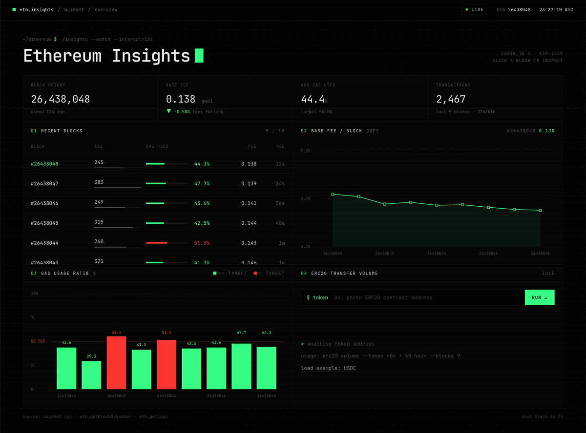

# Real-Time Ethereum Dashboard

An interactive dashboard for visualizing real-time Ethereum network data.

Built with Next.js and TypeScript, this app streams live Ethereum mainnet data
from Alchemy and displays it in a dark, terminal-style interface.

<div align="center">
  
</div>

## Features

- 🔗 Live block feed with a LIVE/PAUSED toggle and the last 10 blocks
- 📈 Key numbers: block height, base fee (with rising/falling), average gas used
  and transactions
- 📊 Charts for:
  - Base fee per block
  - Gas usage against the 50% EIP-1559 target
  - ERC20 transfer counts per block for any token address
- 🖱️ Click a block in any panel to highlight it everywhere

## Tech Stack

- Next.js 15 and React 19
- TypeScript
- SCSS Modules
- Alchemy SDK (mainnet RPC and new-block websocket)
- Hand-drawn SVG charts (no chart library)

## Getting Started

Install dependencies:

```
npm install
```

### Configure Environment Variables

Create a `.env.local` file in the root of the project and add your Alchemy API
key:

```
NEXT_PUBLIC_ALCHEMY_API_KEY=your-alchemy-api-key-here
```

You can get a free API key from: [https://alchemy.com](https://alchemy.com)

Because the variable starts with `NEXT_PUBLIC_`, the key is included in the
browser bundle and anyone using the site can read it. Before deploying, restrict
the key to your site's domain in the Alchemy dashboard so it can't be used
elsewhere.

### Run the Development Server

```
npm run dev
```

Open [http://localhost:3000](http://localhost:3000) to view the app.

Other scripts: `npm run build` (production build), `npm start` (serve the build)
and `npm run lint`.

## Project Structure

```
src/
├── app/
│   ├── components/            # Dashboard panels and charts
│   ├── Dashboard.module.scss  # Page layout styles
│   ├── globals.css            # Design tokens and global styles
│   ├── icon.svg               # Favicon
│   ├── layout.tsx             # Root layout and font
│   └── page.tsx               # Main page
└── lib/
    ├── alchemy.ts             # Alchemy client setup
    ├── chain.ts               # Block, transfer and clock hooks
    └── format.ts              # Number, time and axis helpers
```

## Deployment

Deploy with Vercel:

[](https://vercel.com/new)

## License

MIT License
